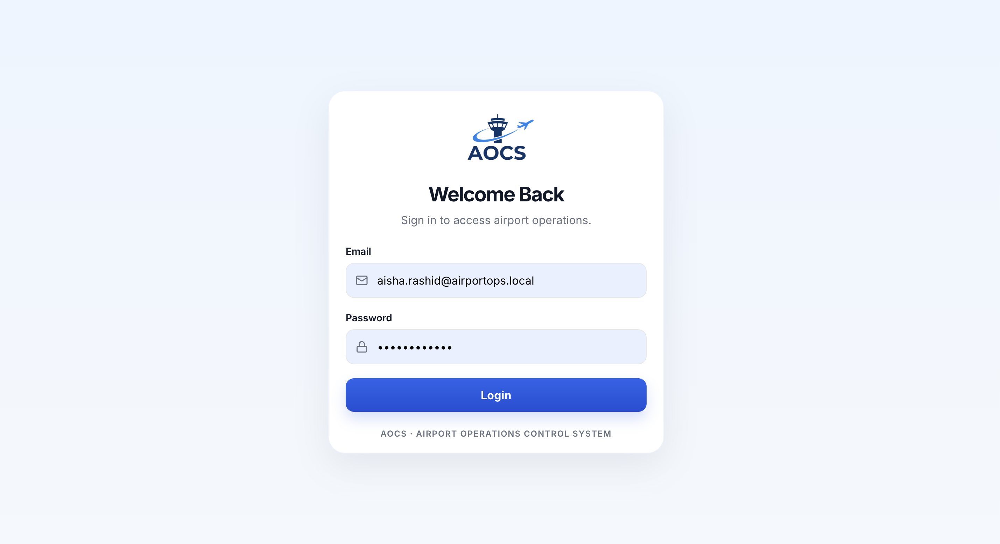
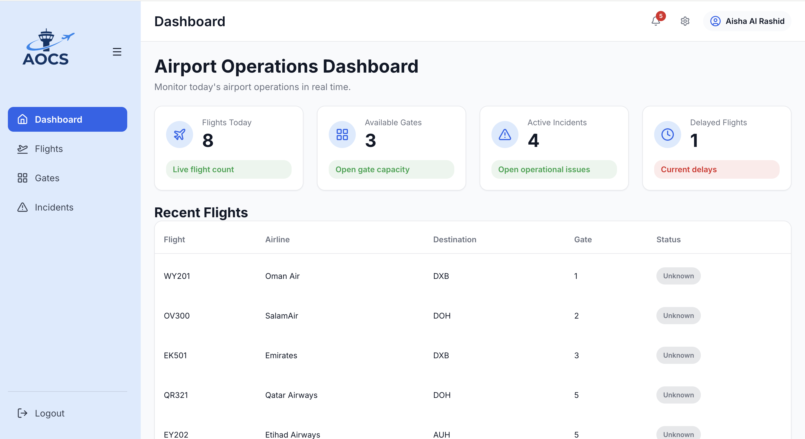
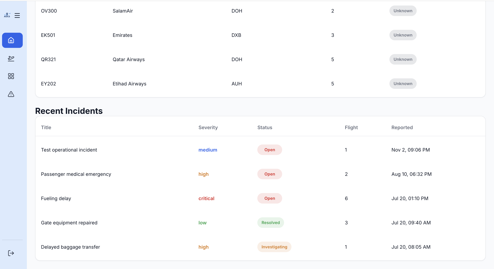
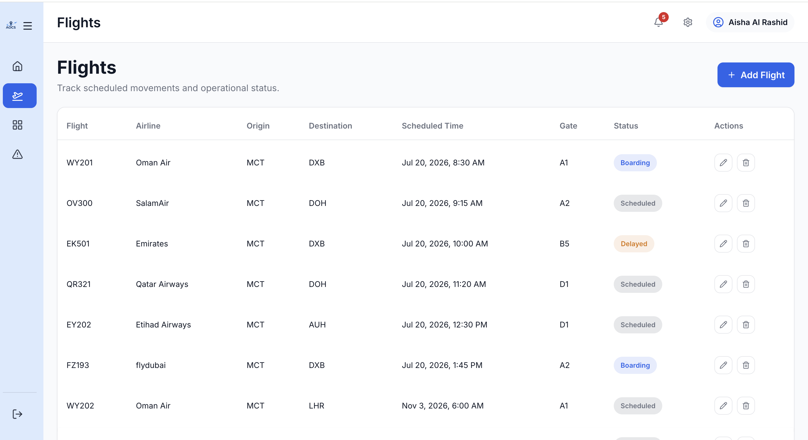
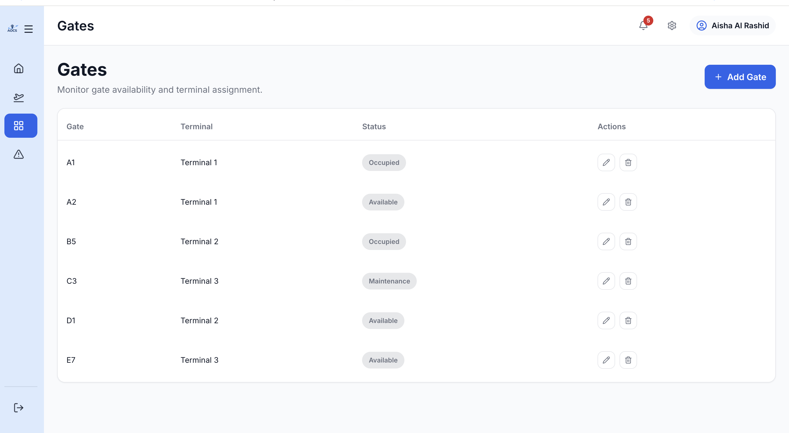
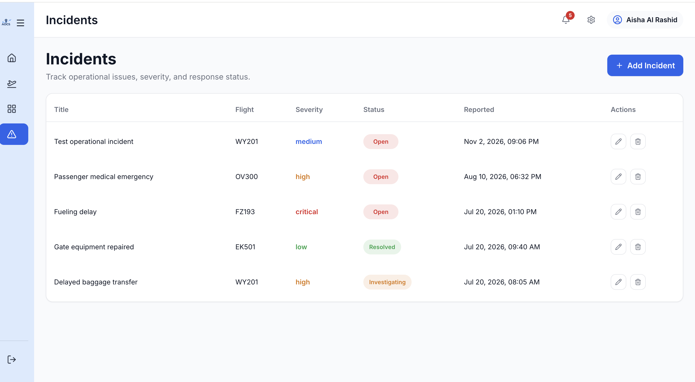

# Airport Operations Control System (AOCS)

A full-stack web application for managing airport operational workflows, including flights, gate assignments, and operational incidents.

## Project Overview

The **Airport Operations Control System (AOCS)** is a web application designed to support day-to-day airport operations management. It provides airport staff with a centralized interface to view operational data, track flights, manage gate assignments, and monitor incidents through a structured dashboard.

The project demonstrates practical full-stack development concepts, including CRUD operations, JWT-based authentication, database management, REST API development, and responsive user interface design.

AOCS is developed as a functional portfolio prototype focused on internal airport operations workflows. It does not currently integrate with live airport systems or external real-time aviation data sources.

## Project Status

**Development Status:** Functional Prototype

Core authentication, dashboard, flight management, gate management, and incident management workflows have been implemented.

## Key Features

- **Operations Dashboard:** Summary cards displaying flights today, available gates, active incidents, and delayed flights.
- **Flight Management:** Create, view, update, and delete flight records.
- **Gate Management:** Manage airport gates and track their availability using available, occupied, and maintenance statuses.
- **Incident Management:** Record and manage operational incidents with severity levels, statuses, and linked flight records.
- **User Authentication:** JWT-based login with protected application routes and authenticated operations.
- **Operational Notifications:** Navigation panel displaying delayed flights and active incidents.
- **Dashboard Settings:** Display preferences for compact dashboard mode and recent incident visibility.
- **Responsive Interface:** Sidebar navigation, interactive tables, forms, and dashboard components.

## Screenshots

### Login


### Dashboard



### Flights


### Gates


### Incidents


## Technology Stack

### Frontend
- React 19
- Vite
- React Router
- Axios
- Lucide React
- CSS

### Backend
- Node.js
- Express.js
- PostgreSQL client (`pg`)
- JSON Web Tokens (JWT)
- bcrypt
- dotenv

### Database
- PostgreSQL
- SQL schema and sample seed data

### Development Tools
- npm
- Nodemon
- ESLint
- Git and GitHub
- Visual Studio Code

## Project Structure

```text
airport-operations-control-system/
├── client/
│   ├── public/
│   ├── src/
│   │   ├── api/
│   │   ├── assets/
│   │   ├── components/
│   │   ├── context/
│   │   ├── pages/
│   │   ├── services/
│   │   └── styles/
│   ├── package.json
│   └── vite.config.js
│
├── server/
│   ├── config/
│   ├── controllers/
│   ├── database/
│   │   ├── schema.sql
│   │   └── seed.sql
│   ├── middleware/
│   ├── routes/
│   ├── tests/
│   ├── app.js
│   ├── server.js
│   └── package.json
│
├── docs/
│   └── screenshots/
│       ├── login.png
│       ├── dashboard.png
│       ├── flights.png
│       ├── gates.png
│       └── incidents.png
│
├── README.md
└── .gitignore
```

## Getting Started

Follow these instructions to run AOCS locally.

### Prerequisites

Make sure you have the following installed:

- Node.js (LTS recommended)
- npm
- PostgreSQL
- Git

### 1. Clone the Repository

```bash
git clone https://github.com/Efaa-AuladThani/airport-operations-control-system.git
cd airport-operations-control-system
```


### 2. Install Dependencies

Install backend dependencies:

```bash
cd server
npm install
```

Install frontend dependencies:

```bash
cd ../client
npm install
```

### 3. Configure Environment Variables

Create a `.env` file inside the `server/` directory.

Add the following variables, replacing the placeholder values with your local PostgreSQL configuration:

```env
DB_HOST=localhost
DB_PORT=5432
DB_NAME=your_database_name
DB_USER=your_database_user
DB_PASSWORD=your_database_password
JWT_SECRET=your_secure_secret
PORT=5000
```

The backend uses these variables for database connectivity and JWT signing.

**Important:** Never commit your actual `.env` file or expose database credentials and JWT secrets. If provided, use `.env.example` to document the required variables with placeholder values.

### 4. Create and Initialize the Database

Create a PostgreSQL database matching the `DB_NAME` value in your environment configuration.

Then, from the project root, run:

```bash
psql -U your_database_user -d your_database_name -f server/database/schema.sql
```

Load the sample data:

```bash
psql -U your_database_user -d your_database_name -f server/database/seed.sql
```

These scripts create the database tables and populate them with sample records.

### 5. Start the Backend

From the project root:

```bash
cd server
npm run dev
```

The backend runs at:

```text
http://localhost:5000
```

### 6. Start the Frontend

Open a second terminal and run:

```bash
cd client
npm run dev
```

The Vite development server typically runs at:

```text
http://localhost:5173
```

Open the frontend URL in your browser to access AOCS.

The frontend communicates with the backend through the Axios API client configured in:

`client/src/api/api.js`

### 7. Build for Production

To generate a production frontend build:

```bash
cd client
npm run build
```

The generated files are placed in the `client/dist/` directory.

## API Overview

The backend exposes REST API endpoints under the `/api` base path.

### Authentication

| Method | Endpoint | Description | Authentication |
|---|---|---|---|
| POST | `/api/auth/login` | Authenticate a user and return a JWT and user profile | No |

### Flights

| Method | Endpoint | Description | Authentication |
|---|---|---|---|
| GET | `/api/flights` | Retrieve all flights | No |
| GET | `/api/flights/:id` | Retrieve a flight by ID | No |
| POST | `/api/flights` | Create a flight | Yes |
| PUT | `/api/flights/:id` | Update a flight | Yes |
| DELETE | `/api/flights/:id` | Delete a flight | Yes |

### Gates

| Method | Endpoint | Description | Authentication |
|---|---|---|---|
| GET | `/api/gates` | Retrieve all gates | No |
| GET | `/api/gates/:id` | Retrieve a gate by ID | No |
| POST | `/api/gates` | Create a gate | Yes |
| PUT | `/api/gates/:id` | Update a gate | Yes |
| DELETE | `/api/gates/:id` | Delete a gate | Yes |

### Incidents

| Method | Endpoint | Description | Authentication |
|---|---|---|---|
| GET | `/api/incidents` | Retrieve all incidents with linked flight information | No |
| POST | `/api/incidents` | Create an incident | Yes |
| PUT | `/api/incidents/:id` | Update an incident | Yes |
| DELETE | `/api/incidents/:id` | Delete an incident | Yes |

### Health Check

| Method | Endpoint | Description |
|---|---|---|
| GET | `/health` | Check backend service status |

## Authentication and Security

AOCS uses JSON Web Tokens (JWT) to authenticate users and protect application functionality.

The authentication flow works as follows:

1. A user submits their email and password through the login page.
2. The backend validates the credentials against the users table.
3. Passwords are verified using bcrypt password hashing.
4. If authentication succeeds, the server generates and returns a JWT.
5. The frontend stores the authentication token and user information in localStorage.
6. Axios automatically attaches the token to API requests using the `Authorization: Bearer` header.
7. Protected routes and authenticated API operations are validated through JWT authentication middleware.

## Future Improvements

Potential enhancements for future versions include:

- Advanced filtering and search across flights, gates, and incidents.
- More granular role-based access control.
- Real-time operational updates through WebSockets.
- Charts and analytics for flight and incident trends.
- Audit logs for operational actions and changes.
- Additional airport operations modules, such as staffing and maintenance planning.
- Integration with external airport information systems and aviation data sources.

## Notes

AOCS is a functional portfolio prototype developed to demonstrate full-stack application development, database integration, authentication, REST API design, CRUD workflows, and operational data presentation.

It is not intended to replace an actual airport operations platform or provide live operational data.